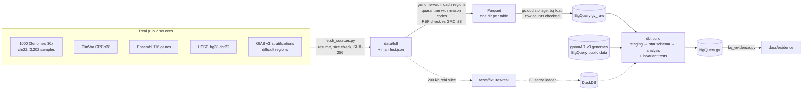

<div align="center">

# genome-vault

**A tested genomic variant warehouse built from real public data: 1000 Genomes, ClinVar, Ensembl, gnomAD and Genome in a Bottle, on BigQuery with dbt.**

[](https://github.com/gbadedata/genome-vault/actions/workflows/ci.yml)
[](LICENSE)
[](https://www.python.org/downloads/release/python-3120/)
[](warehouse/)

[Results](#results) · [How the numbers are checked](#how-the-numbers-are-checked) · [What the findings are](#what-the-findings-are) · [Architecture](#architecture) · [Run it](#run-it) · [Decisions](docs/adr/README.md)

</div>

---

genome-vault loads **all of chromosome 22 from the 1000 Genomes 30x cohort** into a star-schema warehouse on BigQuery:
- 1,066,557 variants;
- 3,202 people from 26 populations;
- 207.5 million genotypes (non-reference calls).

It joins them to ClinVar, Ensembl genes, the gnomAD v3 population frequencies and NIST's map of hard-to-sequence regions. Then it checks itself, and explains what it finds. Every allele count is recomputed from the genotypes and compared with the source. A Hardy-Weinberg test written in SQL reproduces the source's own p-values. gnomAD's coordinate convention is proven from the data, not assumed.

There is no synthetic data anywhere. Tests run on a 200 kb slice cut from the same real files, so CI exercises the same quirks the full run meets. Examples: structural variants that start at the same base, ClinVar entries with no alternate allele, a 0-based column in gnomAD.

## Results

From the full chromosome 22 build on BigQuery ([evidence](docs/evidence/bigquery_full_chr22.md)):

| | |
|---|---|
| Records read from the 1000 Genomes VCF | **1,066,557**, all loaded; 0 quarantined |
| Genotype rows (non-reference calls) | **207,523,964**, 6.1% of the dense 3.42 billion matrix |
| REF alleles checked against GRCh38 | **1,066,557 of 1,066,557** match |
| ClinVar chr22 records | 100,013: 99,961 loaded, 52 quarantined (no ALT allele) |
| dbt models and tests on BigQuery | **56 of 56 pass** (26 models, 30 tests); 75 s for the build |
| Loader, full chromosome on a laptop | 337 s |
| BigQuery cost of a full build | 26.5 GB billed over 56 queries; largest single query 5.2 GB (every query is capped at 20 GB) |

## How the numbers are checked

Every check runs automatically, as a dbt test or in the load script, so a failure stops the run. The figures are from the full chr22 run.

| Invariant | Result | What it proves |
|---|---|---|
| Every record is loaded or quarantined | 1,066,557 = 1,066,557 + 0 | Nothing is silently dropped; any rejection carries a reason code |
| BigQuery row counts equal the Parquet | 11 of 11 tables, checked by the load script | The upload and load jobs lost nothing |
| Allele counts recomputed from genotypes equal the source's AC/AN | **6,399,342 of 6,399,342** (all samples), **5,332,785 of 5,332,785** (unrelated) | The sparse genotype model ([ADR-008](docs/adr/008-sparse-genotype-fact.md)), sample mapping and population joins are exact |
| Exact Hardy-Weinberg test reproduces the source's HWE p-values | **5,325,475 of 5,325,475** (max difference 5e-7, the VCF's float rounding) | The SQL implementation of Wigginton et al. (2005) is right ([ADR-013](docs/adr/013-exact-hwe-on-unrelated-samples.md)) |
| gnomAD's `start_position` is 0-based | 190,739 matches at position+1 vs 7,609 at the raw value | The gnomAD join uses the right coordinates, shown from the data |
| Common SNVs found in gnomAD v3 | above the 90% floor | The join, contig naming and allele normalisation agree |
| GIAB region flags equal a plain range join | 0 differences over the development region; also 0 of 5,452 against an independent Python check | BED coordinates (0-based, half-open) are converted once, correctly, through the windowed join |
| GIAB intervals valid and disjoint; the union contains its components | pass | The 124,292 region intervals loaded as published |

Three of these checks changed the design:
- **"Unrelated" means the 2,504 phase 3 samples, not pedigree founders.** Founders give 2,590 people. Only the phase 3 list reproduces the source's `*_unrel` allele counts exactly.
- **Chi-square was the wrong test.** The first Hardy-Weinberg model flagged 220 departures on the slice where the source flagged 37. Rare variants break the chi-square approximation: one homozygous carrier and no heterozygotes among 661 people scores chi² = 661, while the exact p is 1/1321. The exact test fixed it. Run on all samples, it also showed that the source had computed HWE including relatives.
- **The variant key was too weak for structural variants.** The first full load quarantined two records as duplicates: a `<DEL>` and an `<INS>`, each sharing `chrom:pos:ref:alt` with another record. A symbolic allele says what kind of event it is, not where it ends. With END and SVLEN added to the key for those alleles ([ADR-014](docs/adr/014-structural-variant-identity.md)), both load: they were distinct structural variants, and the quarantine count is now 0.

## What the findings are

Unexplained, the warehouse flags thousands of records:
- 6,368 variants depart from Hardy-Weinberg equilibrium;
- 925 have frequencies that disagree with gnomAD;
- 304 common variants are missing from gnomAD altogether.

Joining every variant to the [Genome in a Bottle](https://www.nist.gov/programs-projects/genome-bottle) v3.6 map of regions where short-read sequencing is known to struggle (`variant_context`, `findings_by_region_class`) shows that **almost all of them are technical, not biological.**

| Finding (counted once per variant) | Variants | In GIAB difficult regions | Rate vs not-difficult regions (95% CI) |
|---|---:|---|---|
| Hardy-Weinberg departure, exact p < 1e-6, unrelated samples | 6,368 | **93.6%** (vs 40.9% of variants tested) | **35×** in segmental duplications (31.6-38.7); 25× in low mappability (21.9-28.5); 12× in tandem repeats and homopolymers (10.8-13.5) |
| Allele frequency differs from gnomAD v3 by > 0.2 | 925 | **94.9%** (vs 41.7%) | **55×** in tandem repeats and homopolymers (41.3-74.5); 10× in segmental duplications (7.4-14.2) |
| Common in 1000 Genomes (AF ≥ 1%), absent from gnomAD v3 | 304 | **303 of 304** | 276 of the 304 are in tandem repeats or homopolymers |

The mechanisms differ by finding:
- **Hardy-Weinberg departures follow duplicated DNA.** In a segmental duplication, reads from two near-identical copies pile onto one. Differences between the copies then look like heterozygous calls. The development slice shows it at CYP2D7, the paralog next to CYP2D6, where heterozygotes ran 28% above expectation.
- **gnomAD disagreements follow repeats.** A long homopolymer can be written several ways. At one poly-A run in CYP2D7, gnomAD lists 281 alleles where 1000 Genomes lists 5, so the same variation lands on different alleles in the two callsets.

The practical result is a defensible filter. **Keeping only GIAB not-difficult regions retains 59% of variants and removes 93.6% of HWE departures and 94.9% of gnomAD disagreements.** The 405 HWE departures left outside difficult regions are the ones worth a closer look. Population structure inside a superpopulation (the Wahlund effect) is one expected cause. One result is not interpreted here: variants in "other difficult" regions depart from HWE *less* often than the baseline (0.35×).

**Sample flags first measured ancestry, not data quality.** Scored against their superpopulation (|z| > 4 on Ti/Tv, het/hom ratio or non-reference sites), 27 samples were flagged. 11 of them were in the admixed ASW and ACB populations, flagged mostly on their count of non-reference sites: mixed ancestry moves that count away from a superpopulation average.

Scored within each of the 26 populations, which now sets the flag, **15 samples are flagged**:
- 13 were flagged before; 2 are new; 14 earlier flags drop, including every ASW and ACB one.
- Most of the 15 have fewer heterozygous calls than their own population (population means of het/hom z from -4.0 to -6.9; PJL, BEB, STU, ESN, KHV and others). That is the signature of long runs of homozygosity, though one chromosome cannot confirm it.

The superpopulation scores are kept beside the population ones (`*_z_superpop`), so the comparison stays visible.

**Two ClinVar "pathogenic" calls are common in a population:**
- a likely-pathogenic MEI1 variant at 1.1% in AFR (several submitters, no conflicts);
- a single-submitter pathogenic EFCAB6 variant at 1.6% in EAS.

A frequency that high in a reference population is a standard prompt to review a classification. The warehouse surfaces them; it does not judge them.

**No record is quarantined.** The two that once were, a `<DEL>` at chr22:22,857,056 and an `<INS>` at chr22:49,951,209, turned out to be distinct structural variants that the old key could not tell apart. Fixing the key loaded them along with their 71 genotype rows, and every allele-count check still holds with them included.

## Architecture



**Ingestion** (`src/genome_vault`):
- One pass over the VCF with cyvcf2, which hands genotypes over as numpy arrays.
- Each record is classified (SNV, MNV, INDEL, SV) and its REF allele checked against GRCh38.
- Records that fail a rule go to a quarantine table with a reason code: `DUPLICATE_VARIANT`, `ALT_MISSING`, `REF_MISMATCH` and others.
- Output is chunked Parquet with explicit schemas, plus a `load_runs` row per source with its SHA-256.

**Warehouse** (`warehouse/`): one dbt project with two targets ([ADR-010](docs/adr/010-dbt-on-duckdb-and-bigquery.md)).

| Layer | Models |
|---|---|
| Staging | Typed views over the raw tables and gnomAD |
| Star schema | `dim_sample`, `dim_population`, `dim_variant` (genes, ClinVar), `variant_context` (GIAB region class), `fct_genotype` (sparse, clustered by variant) |
| Analysis | `variant_population_freq`, `qc_allele_count_reconciliation`, `qc_hardy_weinberg`, `gnomad_concordance`, `qc_gnomad_offset`, `clinvar_in_cohort`, `qc_sample`, `findings_by_region_class`, `qc_summary` |

**Infrastructure** (`infra/terraform`):
- A GCS bucket (90-day lifecycle on run prefixes) and two BigQuery datasets, all in the US so they can join the public gnomAD table ([ADR-011](docs/adr/011-us-location-and-cost-guards.md)).
- A £30 monthly budget alert.

**CI** (GitHub Actions), three jobs:
1. Lint, unit tests, loading the real slice, then `dbt build` on DuckDB.
2. `dbt compile` for BigQuery with an offline profile, with every compiled file parsed as BigQuery SQL.
3. `terraform fmt` and `validate`.

## Run it

### On your laptop, no cloud (about a minute)

The real development slice is committed, so this needs no downloads:

```bash
git clone https://github.com/gbadedata/genome-vault && cd genome-vault
make setup          # Python 3.12 venv with the dev dependencies
make slice          # load the real slice to Parquet, then dbt build on DuckDB
.venv/bin/python -c "import duckdb; print(duckdb.connect('data/work/genome_vault.duckdb').sql('select kind, check_name, passed, detail from qc_summary'))"
```

### Full chromosome 22 on Google Cloud

You need `gcloud`, `bq`, Terraform ≥ 1.9 and a billing-enabled project. The defaults use `genome-vault-202605`; set `GV_PROJECT_ID` and edit `infra/terraform/environments/dev/terraform.tfvars` to use your own.

```bash
pip install -e ".[cloud]"
python scripts/fetch_sources.py          # about 750 MB, resumable; writes data/sources/manifest.json
bash scripts/bootstrap-gcp.sh            # project, billing, APIs, Terraform state bucket (idempotent)
(cd infra/terraform/environments/dev && terraform init && terraform apply)
bash scripts/load_bigquery.sh            # loader, upload, bq load, row-count check (about 15 min)
bash scripts/build_bigquery.sh           # dbt build on BigQuery, then docs/evidence/
```

## Repository layout

```text
src/genome_vault/        loader: VCF, ClinVar, GFF3, samples, GIAB BEDs → Parquet
warehouse/               dbt project: staging, marts, analysis, tests, portable macros
scripts/                 fetch_sources.py, load_bigquery.sh, build_bigquery.sh, bq_evidence.py
infra/terraform/         bucket, datasets, budget (environments/dev)
tests/                   unit tests on the committed real slice (tests/fixtures/real)
docs/adr/                architecture decision records
docs/evidence/           output of each full BigQuery run
```

## Data sources

| Source | Version used | Role |
|---|---|---|
| [1000 Genomes 30x on GRCh38](https://www.internationalgenome.org/data-portal/data-collection/30x-grch38) (NYGC) | Phased SNV/INDEL/SV panel, chr22, 3,202 samples | Genotypes, the source's own AC/AN and HWE for reconciliation |
| 1000 Genomes sample tables | 3,202-sample pedigree; phase 3 panel (2,504 unrelated) | Populations, relatedness |
| [ClinVar](https://www.ncbi.nlm.nih.gov/clinvar/) | GRCh38 VCF, fileDate 2026-11-15 | Clinical significance, joined on chrom/pos/ref/alt (the panel has no rsIDs) |
| [Ensembl](https://www.ensembl.org/) | GRCh38 release 116, chr22 GFF3 | Gene overlap |
| [UCSC hg38](https://hgdownload.soe.ucsc.edu/goldenPath/hg38/chromosomes/) | chr22.fa.gz | REF allele check |
| [gnomAD v3 genomes](https://gnomad.broadinstitute.org/) | `bigquery-public-data.gnomAD.v3_genomes__chr22` | Population frequency comparison |
| [Genome in a Bottle stratifications](https://www.nist.gov/programs-projects/genome-bottle) (NIST) | v3.6, GRCh38 (`GRCh38@all`) | Segmental duplications, low mappability, tandem repeats and homopolymers, union of difficult regions |

Exact file names, sizes, retrieval times and SHA-256 checksums are in `data/sources/manifest.json` after a fetch, and for the committed slice in `tests/fixtures/real/SOURCES_MANIFEST.json`. Each source has its own terms of use; check them before reusing the data.

## Limitations

- **One chromosome.** Everything is built for chr22. The loader runs per chromosome, so the whole genome means 22 parallel loads, not a redesign, but it has not been done.
- **A released panel, not raw calls.** The 1000 Genomes panel is filtered, phased and has no missing genotypes. Findings describe that panel, not a sequencer's raw output.
- **gnomAD v3, not v4.** BigQuery hosts v2.1.1 and v3 only. gnomAD's non-Finnish Europeans (`nfe`) stand in for 1000 Genomes `EUR`, which includes Finns, so some EUR differences are expected.
- **Thresholds are screening thresholds.** HWE departures use p < 1e-6 across about 5.3 million tests, which is not a genome-wide correction. Sample flags (|z| > 4 within population) and ClinVar "common but pathogenic" calls point at records for a person to review. Neither is a verdict, and population-level z-scores still do not adjust for ancestry within admixed populations.
- **Not for clinical use.** This is an engineering and population-genetics project on research data.

## References

- Byrska-Bishop M, et al. High-coverage whole-genome sequencing of the expanded 1000 Genomes Project cohort including 602 trios. *Cell* 2022;185:3426-3440.
- Chen S, et al. A genomic mutational constraint map using variation in 76,156 human genomes. *Nature* 2024;625:92-100.
- Landrum MJ, et al. ClinVar: improving access to variant interpretations and supporting evidence. *Nucleic Acids Res* 2018;46:D1062-D1067.
- Dwarshuis N, et al. The GIAB genomic stratifications resource for human reference genomes. *Nat Commun* 2024;15:9029.
- Wigginton JE, Cutler DJ, Abecasis GR. A note on exact tests of Hardy-Weinberg equilibrium. *Am J Hum Genet* 2005;76:887-893.
- Katz D, et al. Obtaining confidence intervals for the risk ratio in cohort studies. *Biometrics* 1978;34:469-474.

## Licence

Code: [MIT](LICENSE). Data: the terms of each source above.
